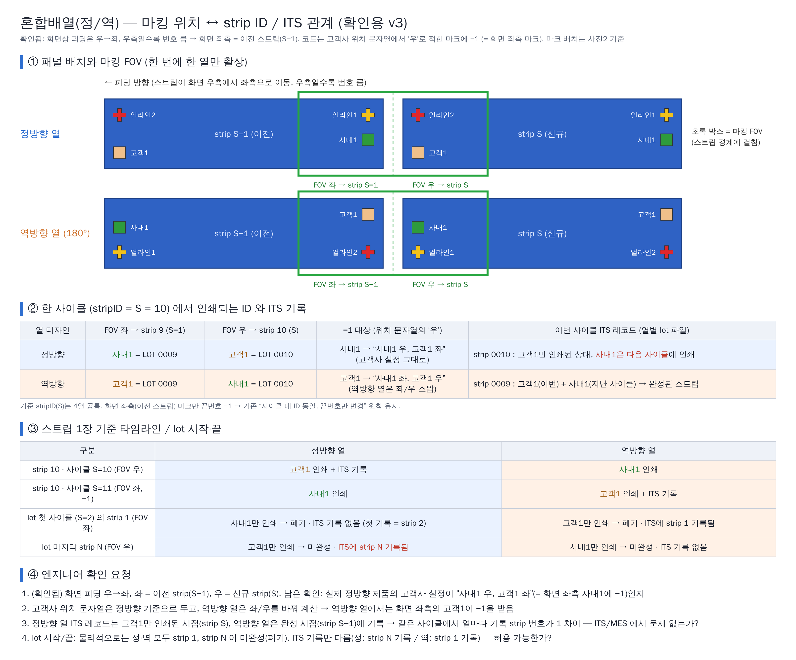

# 02_REFACTOR_PLAN.md — 4열 정/역 혼합 배열 마킹 리팩토링 계획 (v2)

> **v2 개정**: `03_PLAN_REVIEW.md`(1~6차 검토)에서 확정한 내용을 반영해 v1을 다시 썼다. v1은 git 이력(`a057fce`)에 남아 있다.
> **목적**: 4열 마킹에서 열마다 **정방향 / 역방향(180° 회전)** 제품이 섞여 들어와도(예: 정정역역, 역역정정, 정역정역) 기존과 같은 정밀도, 택트, 안정성으로 얼라인 → 레이저 마킹 → 비전 검사 → ID/ITS 기록을 수행한다.
> **기준 경로**: `MarkingPC`(`MachineType=PC`, `TestMode=0`), Vision=`MILCL`, Laser=`Keyence`, 상·하부 양면 마킹.
> 파일 경로는 `HDS_ID_Marker/HDS_ID_Marker/` 기준이다.

---

## 0. 결정사항 요약

| 항목 | 결정 |
|---|---|
| 명칭 | **정방향 / 역방향**. 기존 모델의 데이터는 모두 정방향 |
| 배열 지정 단위 | **lot 단위**. lot 입력창(`LotWindow`)에서 열별로 정/역을 토글한다. 모델에는 저장하지 않는다 |
| 배열 기록 | **로그 파일에만** 남긴다. ITS와 work_history에는 기록하지 않는다 |
| 티칭 | 정/역 **각각 티칭**한다(FOV에는 한 열만 보이므로 자동 생성은 하지 않음). 역방향 티칭 화면에 "정방향 파라미터 복사 + 각도 자동 보정" 버튼을 둔다 |
| 모델 운영 | **기존 모델에 역방향 레시피를 추가**한다. 정방향만 있는 모델은 기존과 동일하게 동작한다 |
| 모션 기준점 | **공통 기준점은 정방향이 소유**한다. 역방향은 티칭할 때 Y를 잠그고, 기준점이 바뀌면 재티칭을 요구한다 |
| ID 규칙 | 고객사 "2D 위치"(Ctrl+I) 값은 **정방향 기준**이다. 역방향 열에서는 이 값의 **좌/우를 모두 맞바꿔** 계산한다 |
| 레이저 | 한 프로그램 안에 정방향 블록 `index`와 역방향 블록 `20 + index`를 함께 등록하고, 열마다 Enable을 토글한다 |
| 범위 제외 | PLC 경로, AOI ID 리더, 마킹 시프트 검사, 티칭창 단발 테스트 버튼. 대신 **시작 차단 가드**로 막는다 |

---

## 1. 기하 및 strip 번호 규칙 (확정)



- 마킹 FOV(사진2의 초록 박스)는 같은 열의 **스트립 경계**에 걸쳐 있다. 한 번에 한 열만 촬상한다.
- 화면에서 피딩은 **우→좌**로 진행하고, 우측으로 갈수록 번호가 크다.
  → **화면 좌측 = 이전 스트립(S−1)**, **화면 우측 = 신규 스트립(S)**.
- 마크 배치(사진2 기준)

| | 화면 좌측 (S−1) | 화면 우측 (S) |
|---|---|---|
| 정방향 열 | 얼라인1(상) + 사내1 | 얼라인2(상) + 고객1(하) |
| 역방향 열 | 고객1(상) + 얼라인2(하) | 사내1 + 얼라인1(하) |

- 코드 규칙(현행, 변경하지 않음): 위치 문자열에서 **'우'로 적힌 마크 = 기준 stripID − 1**(`GetInternal1IDString`, `GetCustomIDString`).
  이 문자열의 좌/우는 화면 기준이 아니라 제품 기준이다. 실제로는 화면 좌측(이전 스트립)에 있는 마크가 '우'에 해당한다.
- 시작번호 2를 입력하면 1번째 스트립은 한쪽 끝만 마킹되어 폐기된다. 2번째 스트립부터 양 끝이 같은 번호가 된다. 정방향과 역방향 모두 같다.
- **역방향 원칙**: 화면의 같은 쪽은 4개 열 모두 같은 물리 스트립이다. 역방향에서 달라지는 것은 그 자리에 오는 마크의 종류(사내1 ↔ 고객1)뿐이다. 따라서 역방향 열은 위치 문자열의 좌/우를 맞바꾸면 된다.

---

## 2. 데이터 모델 / DB (하위 호환)

| 대상 | 변경 | 기존 데이터 |
|---|---|---|
| `para_custommark`, `para_intermark`, `para_ocrmark`, `para_alignroi` | `orient TINYINT NOT NULL DEFAULT 0` (0=정, 1=역) | 모두 정방향(0) |
| `marking_info` | `RevBaseTopY`, `RevBaseBotY` (역방향을 저장한 시점의 기준점 스냅샷, NULL이면 역방향 미티칭) | NULL |
| 모델 폴더 | 정: `Align.bmp`, `Align2.bmp`(기존) / 역: `Align_R.bmp`, `Align2_R.bmp` | 그대로 |
| `CustomMark`/`InterMark`/`OCRMark`/`AlignROI` (`Data/MarkInformation.cs`) | `public int orient;` | 0 |
| 런타임 lot 정보 | `MainWindow.orients = new bool[4]` (물리 열 인덱스 기준, true=역). `lots[]`와 같은 위치에서 설정 | 전부 false |

- 블록 번호: 정방향은 `index`, 역방향은 `20 + index`. `index`는 Variant마다 0부터 매긴다(`AllObjectCount()`, 얼라인 ROI 포함). 상한 20이면 충분한 것으로 확인했다.

### 2.1 런타임 레시피 스냅샷

현재 런타임은 UI 컨트롤의 리스트(`workSettingWindow.topHRControl.customMarks` 등)를 직접 참조한다. 이를 레시피 객체로 바꾼다.

```csharp
class MarkRecipe {
    List<CustomMark> Custom; List<InterMark> Inter; List<OCRMark> Ocr; List<AlignROI> Align;
    Mat AlignTpl1, AlignTpl2;   // 상부만
    int BlockBase;              // 정 0, 역 20
}
MarkRecipe GetRecipe(int row, Surface s) => orients[row] ? Rev[s] : Fwd[s];
```

- 모델 로드(`ModelManager.btnStart_Click` → `SetMarkData`)와 티칭 저장 시점에 정/역 × 상/하 4개를 만든다.
- `LaserMarkingManagement`, `TeachingManagement`, `WorkManagement`의 런타임 코드는 `GetRecipe(i, …)`만 사용한다. 티칭창이 어떤 상태로 닫혀도 런타임 데이터가 보장된다.

---

## 3. 티칭 (`WorkSettingWindow`, `MainHRControl`)

### 3.1 화면
- 상단에 **정방향 / 역방향** 라디오를 둔다. 캔버스에는 선택한 쪽의 ROI만 그리고, 메모리에는 정/역을 항상 함께 보관한다.
- **티칭 열 선택**(1~4): 기존 `btnMove1Row~4Row`와 연동한다. 선택한 열 k의 위치(`기준점 + StripIter[k]`)로 이동한다.
- 역방향 모드에서 **"정방향 파라미터 복사 + 각도 보정"** 버튼을 누르면 같은 `reference`(고객1/고객2/사내1)를 가진 정방향 마크에서 다음을 처리한다.
  - 그대로 복사: size, format, gap, power, speed, flip, shape
  - 각도: `degree + 180`을 Keyence 허용 범위로 정규화한다.
  - 좌/우(`markPos`): 반전한다.
  - 작업자는 ROI 위치만 잡으면 된다.
- `MarkParaSettingWindow`/`OCRParaSettingWindow`가 열릴 때 `markPos`를 고객 문자열로 덮어쓰는 동작(`Window_Loaded`)은, 역방향일 때 **스왑한 문자열**을 기준으로 하도록 바꾼다.

### 3.2 DB 격리 — `MainHRControl`의 모든 SQL에 `orient` 조건 강제
`CreateObjects`(조회), `Save`(INSERT), `Modify`, `isExist`, `Delete`, `DeleteByIndex`, `UpdateIndex`, `GetRemainROICount`, `WorkSettingWindow.DeleteAllClear`.
→ 역방향 화면에서 삭제하거나 인덱스를 갱신해도 정방향 레코드가 바뀌지 않아야 한다(**회귀 테스트 필수**).

### 3.3 저장 규칙 (모션 기준점)

| | 정방향 저장 | 역방향 저장 |
|---|---|---|
| 가드 | `현재Y − StripIter[k] ≤ 90` (기존 `posY > 90`을 티칭 열 기준으로 대체) | 역방향 레시피가 들어 있는 열 k에서만 저장 가능 |
| 모션 좌표 | `TopAlignY = TopMarkY = 현재Y − StripIter[k]` (하부 `BotMarkY`도 같은 방식) | **저장하지 않음**. Y는 `기준점 + StripIter[k]`로 잠금 |
| 템플릿 | `Align.bmp`, `Align2.bmp` | `Align_R.bmp`, `Align2_R.bmp` (정방향 파일 쓰기 금지) |
| 스냅샷 | 저장 후 기준점이 `RevBaseTopY/BotY`와 다르면 **역방향을 "재티칭 필요" 상태로 표시** | `RevBaseTopY/BotY = 현재 기준점` |

- 공통 기준점 + 열 간격 방식은 현재 2~4열을 마킹하는 방식과 같다. 따라서 **마킹 품질이 기존과 같다**.
- 역방향을 **처음 저장하기 전에** 모델을 자동 백업한다(`para_*` 행과 모델 폴더).
- 저장 시 `LoadProjectTop/Bot`을 호출해 정/역 블록을 함께 재등록한다(5장).

---

## 4. 얼라인 (`TeachingManagement`)

- **`MarkingAlignToROI`** (`:178-275`)
  - 0열 측정에는 `GetRecipe(0)`의 얼라인 ROI와 템플릿을, 마지막 열 측정에는 `GetRecipe(last)`의 것을 사용한다.
  - 같은 번호끼리 짝을 짓는다.
  - **기울기 계산 베이스라인 보정**: 현재 식(`alignDistanceY = StripIter[last] − y12`)은 두 마크가 열 안에서 같은 높이에 있다고 가정한다. 정방향 마크는 열 상단, 역방향 마크는 열 하단에 있으므로 이 가정이 깨진다. 실제 ROI 중심 Y의 차이(`(roiCY_last − roiCY_0) · res`)를 더해 계산한다.
- **`MarkingAlignToROI_RightOnly`** (`:277-351`, 첫 사이클)
  - 현재 `number == 2`와 템플릿2로 고정돼 있다. 이를 **각 열 레시피에서 ROI X가 더 큰(화면 우측) 얼라인**과 그 번호의 템플릿으로 바꾼다. 정방향은 2번, 역방향은 1번이다.
- **비전 API**: `SearchPointAlignToROI/Align2ToROI`에 템플릿 `Mat`을 인자로 받는 오버로드를 추가한다(`DCS/Camera/MILCL.cs`, `Vision.cs`). 템플릿 필드를 교체하는 방식은 쓰지 않는다.
- `lastFoundAlignPos`는 시프트 검사 전용이다(범위 밖). 0열 기준을 유지한다.

---

## 5. 레이저 (`LaserMarkingManagement`, Keyence)

- **`LoadProjectTop/Bot`** (`:552-669`)
  - 정방향 블록(`index`)과 역방향 블록(`20 + index`)을 한 프로그램에 함께 등록한다.
  - 역방향 레시피가 비어 있으면 기존과 같다.
  - Head 방향(flip)은 정방향 `customMarks[0].flip`을 기준으로 한다. 정/역의 flip이 다르면 저장할 때 막는다.
- **`TopMark/BotMark`** (`:939-1342`) — 열 i마다:
  - `GetRecipe(i)` 쪽 블록: 해당 레시피의 ROI로 위치를 계산하고 `MarkingEnable=2,1`을 보낸다.
  - **반대쪽 블록 전부: `MarkingEnable=2,0`을 명시적으로 보낸다.** 이전 상태가 남기 때문에 생략하면 안 된다.
  - 레이저 재로드는 없다. MARK 명령 길이만 조금 늘어난다.
- **검증 필요**: 180° 블록이 **블록 중심 기준**으로 회전하는지 확인한다(현재 위치 계산 `GetCenterX/Y`는 각도를 무시함). 시편으로 같은 좌표에 0°와 180°를 각각 마킹해 비교한다.

---

## 6. ID / ITS (`WorkManagement`, `MainWindow`)

```csharp
// "사내1 우, 고객1 좌, 고객2 우" → "사내1 좌, 고객1 우, 고객2 좌"
string GetRowMarkingLocation(int row) =>
    orients[row] ? SwapLR(customerInformation.MarkingLocation) : customerInformation.MarkingLocation;
```

`SwapLR`은 모든 토큰의 좌↔우를 맞바꾼다. 고객사 정보창 "2D 위치" 콤보박스의 8개 조합은 이 변환으로 서로 짝지어지므로, 결과는 항상 유효한 조합이다.

적용 위치는 아래 전부다. 공통 `MarkingLocation`을 직접 넘기는 곳을 남기면 안 된다.

| 위치 | 내용 |
|---|---|
| `WorkManagement.MarkingPC` `:1229-1231` | 열별 `Cust1/Cust2/Int1` ID 생성 |
| `:1264`, `:1333`, `:1396` | 열별 `WriteITSOneShot(ConvertInternal1ID(…))` → 열 i의 문자열로 변환 |
| `:1273`, `:1340`, `:1403` | `SaveWorkHistory(Int1_id[0], …)` → **0열 문자열** |
| `:1553` | 종료 시 `WriteITS(ConvertInternal1ID(Int1_id, …))` → 열별로 변환하도록 수정 |
| `MainWindow.GetMarkData` `:638-645` | 작업 시작 전 ID 미리보기 |
| `MarkingTEST` (`:1713~`) | 같은 방식으로 적용(하드웨어 없이 검증할 때 사용) |

- 기준 stripID(S)는 4열 공통이고, '우' 마크만 −1 한다. 기존 원칙은 그대로 유지된다.
- **ITS 결과(미결 확인 항목)**: 같은 사이클에서 정방향 열은 고객1만 인쇄된 strip S를, 역방향 열은 완성된 strip S−1을 기록한다(그림 ②·③). lot 시작과 끝에서는 정/역 모두 strip 1과 strip N이 물리적으로 미완성이다. ITS 기록만 다르다(정: strip N 기록 / 역: strip 1 기록).

---

## 7. 마킹 후 비전 검사 (`CheckMarks2`, `CheckMarksParallel`)

- 열 i마다 `GetRecipe(i, TOP/BOT).Custom` 중 기준 마크(`RefComparer` 정렬 후 [0])의 ROI와 format을 사용한다.
- 기존 결함을 함께 수정한다.
  - 하부 디코딩이 상부 format을 참조하는 문제(`:2545`, `:2783`)
  - `DecodeMarkJob`의 `Decode(…, side, 0, …)`가 열 인덱스를 0으로 고정한 문제(`:2829`): 인식 이미지가 모두 1열 lot 이름으로 저장된다.
- ZXing은 `AutoRotate=true`라 180° 마크를 디코딩한다. 폴백 알고리즘 `Get_Algo_Conv_Square_DataMatrixHJ`는 역방향 시료로 따로 확인한다.
- 마킹 시프트 검사(`CheckMarkShift`)는 범위 밖이다. 8장의 가드로 막는다.

---

## 8. lot 입력창 / 시작 전 가드 / 로그

### 8.1 `LotWindow`
- `tbLotA~D` 옆에 정/역 토글을 둔다.
- `lots[]`와 **같은 `MarkingDirection` 매핑**(`LotWindow.xaml.cs:127-140`)을 거쳐 물리 열 인덱스 기준 `orients[]`에 저장한다. 그대로 저장하면 D→A 모델에서 정/역이 뒤집힌다.
- 역방향이 티칭되지 않았거나 "재티칭 필요" 상태이면 역 토글을 비활성화하고 사유를 표시한다.
- `WorkMarkInfoWindow`(시작 전 확인창)에 열별 정/역과 ID 미리보기를 함께 표시한다.

### 8.2 시작 차단 가드 (`StartMarking` 진입부)

배열에 역방향이 하나라도 있으면 아래 조건 중 하나라도 해당할 때 시작을 막는다.

| 조건 | 메시지 |
|---|---|
| 역방향 레시피 없음(상부, `MarkingMethod`에 따라 하부도), 얼라인 ROI 1·2 없음, `Align_R/Align2_R.bmp` 없음 | 역방향 티칭 데이터 누락 |
| 기준점 ≠ `RevBaseTopY/BotY` | 정방향 기준점 변경 → 역방향 재티칭 필요 |
| `UseAOIMark = true` | 역방향 배열은 AOI 미지원 |
| `MakringShiftCheck = true` | 역방향 배열은 시프트 검사 미지원 |
| `MachineType ≠ PC` | 역방향 배열은 PC 모드만 지원 |

### 8.3 로그
- 작업을 시작할 때(`LogMarkData`) lot, 열별 lot 번호, **열별 정/역**, 정/역 레시피 요약을 남긴다.
- 사이클마다 열별 정/역, 사용한 블록군, 위치 문자열을 Laser 로그에 남긴다.

---

## 9. 단계별 구현

| Phase | 내용 | 완료 기준 |
|---|---|---|
| 1. 데이터 | DB 컬럼(`orient`, `RevBase*`), 구조체 필드, `MarkRecipe`/`GetRecipe`, `orients[]` | 기존 모델을 로드했을 때 정방향 레시피가 기존 리스트와 일치 |
| 2. 티칭 | 정/역 라디오, 티칭 열 선택, 쿼리 `orient` 격리, 저장 규칙, 파라미터 복사 버튼, 백업 | 역방향 저장·삭제·인덱스 갱신 후 정방향 DB 행이 변하지 않음 |
| 3. 레이저·얼라인 | 블록 이중 등록과 Enable 토글, 얼라인 레시피·템플릿 선택, 베이스라인 보정, RightOnly 우측 선택 | 정정정정 lot의 MARK 명령 로그가 기존과 **동일**(역방향 블록 Disable만 추가) |
| 4. ID·검사·UI | `GetRowMarkingLocation` 적용, 열별 검사 ROI·format, `LotWindow` 토글, 가드, 로그 | `MarkingTEST`로 정정역역·역역정정 ID와 ITS 기록 검증 |

### 실기 검증
1. Keyence 시편 테스트: 0°/180° 회전 기준점
2. 정정정정 lot 회귀 테스트(기존 모델, 재티칭 없이)
3. 혼합 시료(정정역역, 역역정정)로 얼라인 → 마킹 → 디코딩 → ID 확인. strip 1 폐기와 2번부터 양품인 흐름을 정/역 열 모두에서 확인
4. 정방향을 재티칭한 뒤 역방향 "재티칭 필요" 차단이 동작하는지 확인

---

## 10. 미결 / 범위 밖

| 구분 | 항목 |
|---|---|
| 미결 | ITS/MES가 6장의 열별 기록 시점 차이와 lot 시작/끝 기록 차이를 받아들이는지 |
| 미결 | Keyence 180° 회전 기준점(시편) |
| 범위 밖 | `MarkingPLC`/`WorkSettingControl`(PLC), AOI ID 리더, 마킹 시프트 검사, 티칭창 단발 마킹/리딩 테스트 버튼 |
| 별도 버그 | `ModelManager.RestoreSelectedModel` `:115`에서 `MarkingDirection`이 `MarkingLeft`로 덮어써짐(별도 작업) |
